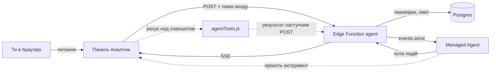
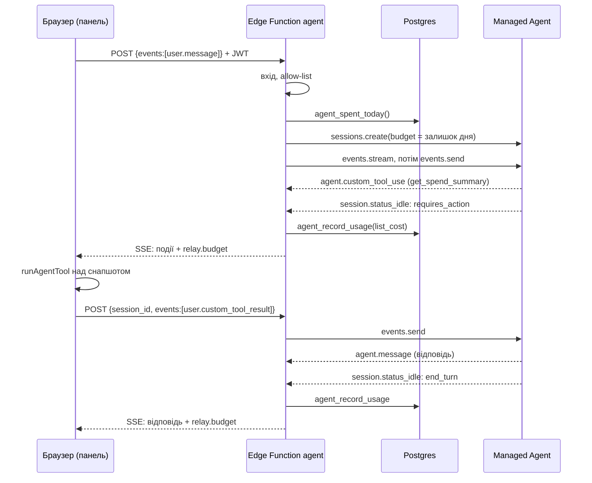

# Аналітик spend-lens: як вбудовано Managed Agent

Справа внизу дашборда є кнопка «Аналітик». Вона відкриває бічну панель розмови: питаєш про свої витрати на Claude Code і отримуєш відповідь із числами дашборда та готовими промптами, як витрати зменшити. Відповідає агент Claude, який живе в Anthropic (Managed Agents), а числа рахує сам дашборд у твоєму браузері.

## 1. Загальна схема

```
 Браузер (GitHub Pages)                   Supabase                          Anthropic
┌──────────────────────────┐   POST    ┌──────────────────────────┐  API   ┌─────────────────────────┐
│ Дашборд React            │ ────────> │ Edge Function `agent`    │ ─────> │ Managed Agents          │
│  ├ AgentChat (панель)    │           │  ├ перевірка входу       │        │  ├ Agent v2 (Opus 5.5)  │
│  ├ agentClient (потік)   │ <──────── │  ├ allow-list            │ <───── │  ├ Session (розмова)    │
│  └ agentTools (числа)    │   SSE     │  ├ денний ліміт          │ events │  └ Environment (без     │
│        │                 │           │  └ облік витрат          │        │     мережі)             │
│        v                 │           └──────────┬───────────────┘        └─────────────────────────┘
│ снапшот витрат (usage)   │                      │ RPC
└──────────────────────────┘           ┌──────────v───────────────┐
                                       │ Postgres                 │
                                       │  ├ allowed_users         │
                                       │  ├ agent_spend (день)    │
                                       │  └ agent_sessions        │
                                       └──────────────────────────┘
```

Головна ідея: **агент думає в Anthropic, а рахує дашборд.** Агент не має доступу ні до бази, ні до файлів, ні до мережі. Коли йому потрібні числа, він просить інструмент, браузер рахує відповідь тими самими функціями, що малюють вкладки, і повертає результат агенту.



## 2. Технології і що це таке

| Технологія | Що це | Роль у spend-lens |
|---|---|---|
| **Claude Managed Agents** | Сервіс Anthropic, де агент зберігається на сервері, а цикл «модель, інструмент, модель» крутить сама Anthropic. Бета `managed-agents-2026-04-01`. | Мозок аналітика. |
| **Agent** | Збережений опис агента: модель, system prompt, інструменти. Має **версії**: кожна зміна дає нову. | `spend-lens analyst`, модель `claude-opus-5-5`, effort `medium`, версія 2. |
| **Environment** | Шаблон пісочниці, в якій працює сесія. | `spend-lens-env` з мережею `limited` без дозволених адрес, тобто без інтернету. |
| **Session** | Одна розмова, закріплена за конкретною версією агента. Памʼятає історію. | Створюється на перше питання в панелі; «нова розмова» починає наступну. |
| **Events + SSE** | Сесія спілкується подіями (`user.message`, `agent.message`, `agent.custom_tool_use`...). SSE (Server-Sent Events) це текстовий потік `data: {...}` по HTTP, де сервер шле події по мірі появи. | Так відповідь іде з Anthropic через функцію в браузер. |
| **Custom tools** | Інструменти, які агент лише **просить**, а виконує твій код. Сесія стає на паузу (`requires_action`) і чекає результату `user.custom_tool_result`. | Три інструменти над снапшотом: підсумок витрат, найдорожчі сесії, фактори перевитрати. |
| **Anthropic SDK** (`@anthropic-ai/sdk` 1.3.0) | Офіційна бібліотека для API Anthropic. | Скрипти в `agent/` і Edge Function. |
| **Supabase Auth** | Вхід користувачів (Google, пошта). Видає JWT: підписаний токен «хто ти», живе годину. | Тим самим входом, що й дашборд, підтверджується право питати агента. |
| **Supabase Edge Functions** | Серверні функції на Deno (TypeScript), які запускаються по HTTP поруч із базою. Мають **секрети**: змінні середовища, яких не бачить браузер. | Функція `agent`: міст між браузером і Anthropic, тримає ключ API. |
| **Postgres + RLS** | База Supabase. RLS (Row Level Security) вирішує, хто які рядки бачить. | `allowed_users` (хто має доступ), облік витрат агента. Таблиці обліку закриті для всіх, крім функції. |
| **React + Vite** | Бібліотека інтерфейсу і збирач фронтенду. | Панель `AgentChat`, клієнт `agentClient`. |
| **GitHub Pages + Actions** | Хостинг статичного сайту і CI, що збирає його на кожен пуш у `main`. | Публікує дашборд разом із панеллю. |

## 3. Як ми вбудували агента (по кроках)

| Крок | Що зроблено | Де |
|---|---|---|
| 0 | Ключ API Anthropic поклали в `agent/.env`, який git ігнорує. | `agent/.env` |
| 1 | Встановили SDK у теку `agent/`. | `agent/package.json` |
| 2 | Описали агента **як код** і написали скрипт синхронізації: перший запуск створює, наступні оновлюють. ID записуються в `agent.json`, тому другого агента не буде. | `agent/definition.mjs`, `agent/setup.mjs`, `agent/agent.json` |
| 3 | Перевірили в Console: агент з трьома інструментами, environment без мережі. | platform.claude.com |
| 4 | Перша сесія з терміналу: агент попросив інструмент, ми порахували його над `usage.json` і повернули результат. Відповідь звірили скриптом. | `agent/try.mjs`, `web/src/lib/agentTools.js` |
| 5 | Секрети в Supabase: ключ, ID агента, версія, ID environment. | Supabase → Edge Functions → Secrets |
| 6 | Edge Function `agent`: вхід, allow-list, створення чи продовження сесії, пересилання потоку до паузи. Перевірили двома curl-запитами вручну. | `supabase/functions/agent/index.ts` |
| 7 | Виправили привʼязку CLI до правильного проєкту, задокументували розгортання. | `supabase/README.md` §9 |
| 8 | Панель «Аналітик» справа внизу в стилі дашборда. Браузер сам крутить цикл «питання, інструмент, результат». | `web/src/components/AgentChat.jsx`, `AgentChat.css`, `web/src/lib/agentClient.js` |
| 9 | Денний бюджет $1, облік витрат у базі, стеля на кожну сесію. Версія 2 агента без тире. | `supabase/migrations/005_agent_spend.sql` |

Урок кроку 7: функцію спершу розгорнули в інший проєкт Supabase. Шлюз відповідав `UNAUTHORIZED_ASYMMETRIC_JWT`, бо токен дашборда підписаний ключем свого проєкту, а чужий проєкт його не визнає. Поле `iss` усередині токена одразу показало, звідки він.

## 4. Шлях одного питання



Один POST дає один **відрізок** розмови: функція пересилає події, доки сесія не стане на паузу. Якщо пауза через інструмент, браузер рахує його і шле наступний POST. Типове питання займає два відрізки і 4-14 секунд.

До кожного питання панель непомітно додає зріз, відкритий у дашборді, наприклад `period_days=30, project="..."`. Тому питання «скільки за цей період?» агент рахує саме за ним.

## 5. Безпека

- **Ключ Anthropic** лежить лише в секретах Supabase і в локальному `agent/.env`. У браузер і в git він не потрапляє.
- **Хто може питати**: лише користувач із входом, чия пошта є в `allowed_users`. Це той самий список, що відкриває дашборд.
- **Чужі сесії**: функція записує власника в `metadata.owner` і не продовжує сесію іншого користувача (403).
- **Що може надіслати браузер**: лише `user.message` і `user.custom_tool_result`, тіло до 200 КБ.
- **Що бачить агент**: агрегати за днями, проєктами, моделями й сесіями. Шляхів до файлів і текстів переписки немає. Мережі в пісочниці немає.
- **Відповідь агента** показується як текст: markdown розбирається без `innerHTML`, тож розмітка з відповіді не виконується.

## 6. Гроші

| Що | Значення |
|---|---|
| Денний ліміт | $1 на всіх користувачів разом, київський день; секрет `SPEND_LENS_DAILY_BUDGET_CENTS` |
| Стеля сесії | залишок дня на момент створення сесії (`budget.max_list_cost` в Anthropic) |
| Облік | `session.usage.list_cost` кумулятивний, у центах; база додає до дня лише приріст |
| Вичерпано | функція відповідає 429, панель пише, що ліміт оновиться опівночі за Києвом |
| Вартість у тестах | перше питання 1-3 центи, друге в тій самій сесії ще близько 2 центів (кеш промпта дешевшає з кожним питанням) |

Внизу панелі після кожної відповіді видно «сьогодні $0,08 з $1,00».

## 7. Файли

| Файл | Що в ньому |
|---|---|
| `agent/definition.mjs` | опис агента й environment: модель, system prompt, три інструменти |
| `agent/setup.mjs` | синхронізація опису з API, нова версія на кожну зміну |
| `agent/agent.json` | ID environment, агента і поточна версія (не секрет) |
| `agent/try.mjs` | пробна сесія з терміналу |
| `web/src/lib/agentTools.js` | виконання інструментів над снапшотом (ті самі функції, що й вкладки) |
| `web/src/lib/agentClient.js` | POST, розбір SSE, цикл інструментів, обробка помилок |
| `web/src/components/AgentChat.jsx` | кнопка, панель, повідомлення, markdown, підказки |
| `web/src/components/AgentChat.css` | вигляд на токенах дашборда, телефон, reduced-motion, друк |
| `supabase/functions/agent/index.ts` | Edge Function: вхід, ліміт, сесії, потік, облік |
| `supabase/migrations/005_agent_spend.sql` | таблиці й функції обліку витрат |

## 8. Як змінювати

**Змінити поведінку агента** (prompt, інструменти):
```powershell
cd agent; node --env-file=.env setup.mjs; cd ..
```
Скрипт надрукує `версія N -> N+1`. Нова версія вмикається лише після оновлення секрету:
```powershell
npx supabase secrets set SPEND_LENS_AGENT_VERSION=<N+1> --project-ref <project-ref>
```
Відкотити версію: те саме зі старим номером.

**Змінити денний ліміт** (у центах, наприклад $2):
```powershell
npx supabase secrets set SPEND_LENS_DAILY_BUDGET_CENTS=200 --project-ref <project-ref>
```

**Новий інструмент**: опис у `definition.mjs`, виконання в `agentTools.js`, підпис статусу в `TOOL_LABEL` панелі, потім `setup.mjs` і секрет версії.

**Діагностика**:

| Симптом | Причина |
|---|---|
| `UNAUTHORIZED_ASYMMETRIC_JWT` | токен з іншого проєкту Supabase або прострочений |
| 403 «доступ заборонено» | пошти немає в `allowed_users` |
| 429 | денний ліміт вичерпано |
| 503 | бракує секрету або міграції 005 |
| «Зʼєднання з аналітиком обірвалося» | мережа обірвала потік; наступне питання почне нову розмову |

Логи функції: Supabase → Edge Functions → agent → Logs.

## 9. Що лишилось

- Описати аналітика в `CONTRACT.md` (зараз там незакомічена робота іншої сесії).
- Відновлення відрізка, обірваного на 2 хвилинах (`relay.timeout`), через `events.list`.
- Текст відповіді зараз приходить цілком; поступовий показ можливий через `event_deltas`.
